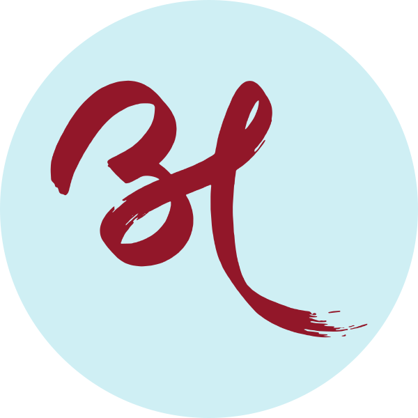

# Big TOP label logo

The "अ" brush mark on a light-blue disc, from `big-top-label-logo.ai` (Illustrator 30, two artboards: 3 × 3 in and 4 × 4 in).



## Getting a CorelDRAW .cdr
CorelDRAW's .cdr format is closed, and no open-source tool can write it. So these files are formats CorelDRAW opens as fully editable vectors. To make the .cdr:

1. In CorelDRAW, **File → Open** `big-top-label-logo.pdf`. Both artboards open as pages 1 and 2. For older CorelDRAW versions, use **File → Import** on one of the `.eps` files and pick *PostScript Interpreted*.
2. **File → Save As → CDR - CorelDRAW**.

| File | Use |
|---|---|
| `big-top-label-logo.pdf` | **Best for CorelDRAW.** Clean PDF 1.4 with both artboards as pages. CMYK. |
| `big-top-label-logo_3in.eps`, `_4in.eps` | One artboard each, CMYK. Works in every CorelDRAW version, and printers accept it. |
| `big-top-label-logo_3in.svg`, `_4in.svg` | One artboard each, sRGB. For web, Inkscape and Canva. |
| `big-top-label-logo.ai` | Original Illustrator source. |
| `*.png` | Previews. |

The paths are the original curves, unchanged. Nothing was re-traced.

## Colours (CMYK, from the .ai)
| Element | C | M | Y | K | sRGB (SVG) |
|---|---|---|---|---|---|
| Disc | 18.8 | 0.4 | 3.5 | 0 | `#cceaf3` |
| Brush mark | 26.6 | 100 | 86.3 | 25.8 | `#97323b` |

## Regenerate
```
pip install pikepdf pillow
python3 scripts/convert_logo_for_corel.py brand/big-top-label-logo/big-top-label-logo.ai brand/big-top-label-logo big-top-label-logo
```
