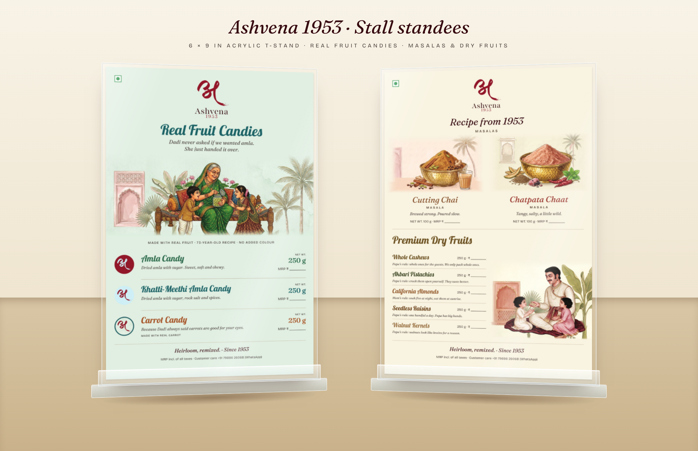

# Ashvena 1953: Stall signage

Two 6 × 9 in table standees for the stall's acrylic T-stands, built to the **Ashvena Brand & Packaging Guidelines 2026 (v1.0)**.



| File | What it is |
|---|---|
| `stall-standees/ashvena-standee_real-fruit-candies.*` | Standee 1: Amla Candy, Khatti-Meethi Amla Candy, Carrot Candy |
| `stall-standees/ashvena-standee_masalas-dry-fruits.*` | Standee 2: Cutting Chai and Chatpata Chaat masalas (recipe from 1953), plus the premium dry fruits |
| `*.svg` | Editable master (live text, named layers: `Logo_Stacked`, `Title`, `Illustration`, `Product_*`, `Footer`, `Guides`) |
| `*.pdf` | Print proof with fonts embedded |
| `*.png` | Preview |
| `brand/ashvena-logo-stacked.svg` | Vector stacked logo, lifted from guidelines p. 4 |
| `stall-standees/art/` | Approved watercolour art and candy lids, cropped from the guidelines (see below) |

## Size
- **Trim:** 152.4 × 228.6 mm (6 × 9 in).
- **Artboard:** 158.4 × 234.6 mm, which includes **3 mm bleed** on every side. Trim marks are on the hidden `Guides` layer.
- **Safe area:** 6 mm inside the trim. The bottom ~10 mm of the trim sits behind the stand's front lip, so it carries no copy.

## How the guidelines are applied
- **Logo:** the stacked logo (अ mark + Ashvena + 1953), centred at the top, in its original colours, on a light wall. Its clear space is at least the height of the word "Ashvena". The veg mark sits top-left.
- **Type:**
  - Lobster for titles on the heritage ranges only: *Real Fruit Candies*, the candy names, *Premium Dry Fruits* and the dry-fruit names.
  - Fraunces (9 pt optical size) for the modern masala titles, taglines and the sign-off.
  - Bricolage Grotesque (14 pt) for category words, NET WT., the MRP lines and the claims strip.
- **Colour:** each title uses its range's title colour from p. 6:

  | Product | Title colour |
  |---|---|
  | Amla Candy | #2D6C4C |
  | Khatti-Meethi Amla Candy | #1C6467 |
  | Carrot Candy | #A85325 |
  | Cutting Chai | #81461F |
  | Chatpata Chaat | #982820 |
  | Whole Cashews | #6C5020 |
  | Akbari Pistachios | #414A27 |
  | California Almonds | #985E31 |
  | Walnut Kernels | #9A7040 |
  | Seedless Raisins | #6D441B |

  Seedless Raisins uses its darkest range colour, because its title colour #D3992C is too pale at list size.
- **Walls:** the backgrounds are the range walls: Khatti-Meethi aqua-sage for the candies, warm cream for the pantry card.
- **Illustration:** only approved art is used. The candy card carries the Dadi scene (heritage), the masalas the hammered brass bowls with no people (modern), and the dry fruits the Papa scene (heritage). The art was cropped clear of the baked-in type, and its edges were faded into the wall in software. No bowl or figure is cropped, and none sits under type.
- **Copy:** taglines come from the copy library (p. 26). The candy claims strip uses the allowed claims only, and Carrot carries its own "Made with real carrot". The sign-off is "Heirloom, remixed. · Since 1953". The customer-care line is the fixed text.

## Copy deck

**Standee 1: Real Fruit Candies**

| | Name | Line | Pack |
|---|---|---|---|
| Title | Real Fruit Candies | *Dadi never asked if we wanted amla. She just handed it over.* | |
| Strip | | MADE WITH REAL FRUIT · 73-YEAR-OLD RECIPE · NO ADDED COLOUR | |
| 1 | Amla Candy | *Dried amla with sugar. Sweet, soft and chewy.* | NET WT. 250 g · MRP ₹ ____ |
| 2 | Khatti-Meethi Amla Candy | *Dried amla with sugar, rock salt and spices.* | NET WT. 250 g · MRP ₹ ____ |
| 3 | Carrot Candy | *Because Dadi always said carrots are good for your eyes.* · MADE WITH REAL CARROT | NET WT. 250 g · MRP ₹ ____ |

**Standee 2: Masalas & Dry Fruits**

| | Name | Line | Pack |
|---|---|---|---|
| Head | *Recipe from 1953* · MASALAS | | |
| 1 | *Cutting Chai* MASALA | *Brewed strong. Poured slow.* | NET WT. 100 g · MRP ₹ ____ |
| 2 | *Chatpata Chaat* MASALA | *Tangy, salty, a little wild.* | NET WT. 100 g · MRP ₹ ____ |
| Head | Premium Dry Fruits | | |
| 3 | Whole Cashews | *Papa's rule: whole ones for the guests. We only pack whole ones.* | 250 g · ₹ ____ |
| 4 | Akbari Pistachios | *Papa's rule: crack them open yourself. They taste better.* | 250 g · ₹ ____ |
| 5 | California Almonds | *Mum's rule: soak five at night, eat them at sunrise.* | 250 g · ₹ ____ |
| 6 | Seedless Raisins | *Papa's rule: one handful a day. Papa has big hands.* | 250 g · ₹ ____ |
| 7 | Walnut Kernels | *Papa's rule: walnuts look like brains for a reason.* | 250 g · ₹ ____ |

**Footer (both):** *Heirloom, remixed. · Since 1953* · MRP incl. of all taxes · Customer care +91 79886 26068 (WhatsApp)

## Before print, fill in or confirm
- **MRP:** fill `MRP` in `scripts/generate_standees.py` (for example `{"amla": "180"}`) and regenerate. Any MRP left empty prints a write-in line.
- **New copy (not in the copy library):**
  - "Real Fruit Candies" and "Recipe from 1953", which match the allowed 73-year-old-recipe claim.
  - The Amla Candy line *"Dried amla with sugar. Sweet, soft and chewy."*: check it against that candy's ingredients.
  - The Khatti-Meethi line is its legal descriptor from the tin.
- **Pack sizes:**
  - Candies: 250 g (tin spec).
  - Masalas: 100 g.
  - Dry fruits: 250 g. The Walnut Kernels jar is taller, so confirm its weight.
- **Colour:** the PDFs are RGB proofs. The guidelines print in CMYK, so convert in Illustrator from the HEX values, or have the printer do it.
- **CorelDRAW:** outline the text first (guidelines p. 27).
- **Art resolution:** the art comes from the scenes embedded in the guidelines PDF, about 150 to 200 ppi of real detail, upscaled 2× for print. That is fine for a table standee. For a sharper print, re-crop from the 300 ppi masters in *Final Packaging Designs* using the same file names in `stall-standees/art/`.

## Fonts
Fraunces (9 pt optical size), Bricolage Grotesque (14 pt optical size) and Lobster. All three are free Google Fonts under the SIL OFL. Install them before opening the SVGs.

## Regenerate
```
pip install playwright pillow fonttools
python3 scripts/prepare_standee_art.py Ashvena-Brand-Packaging-Guidelines-2026.pdf   # art/ + logo (needs poppler)
python3 scripts/generate_standees.py                                              # SVG masters
python3 scripts/render_previews.py signage                                        # PNG + PDF
python3 scripts/render_standee_board.py                                           # mockup board
```
