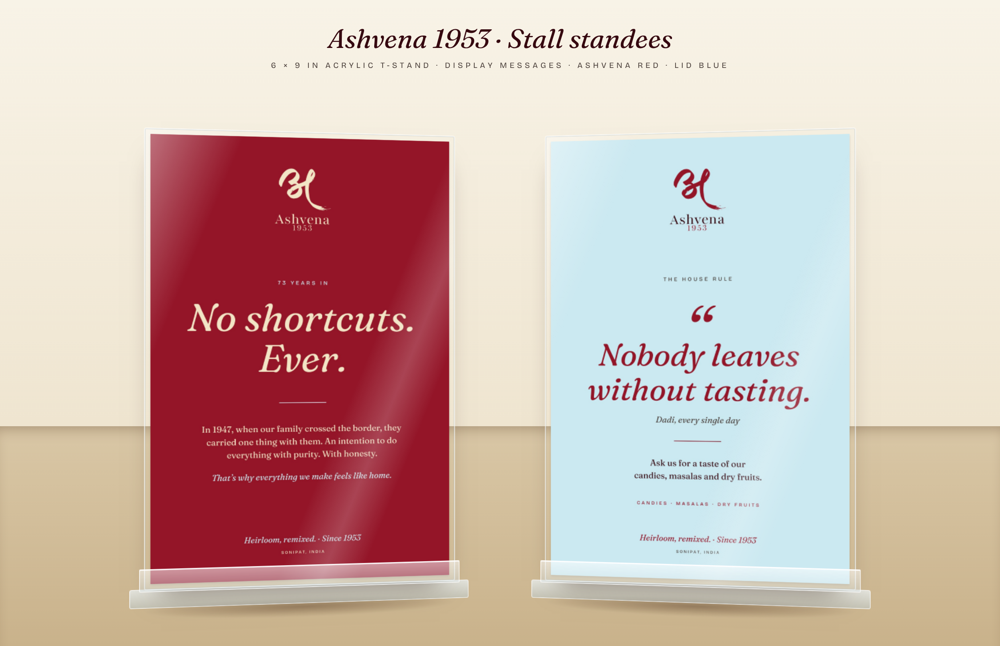
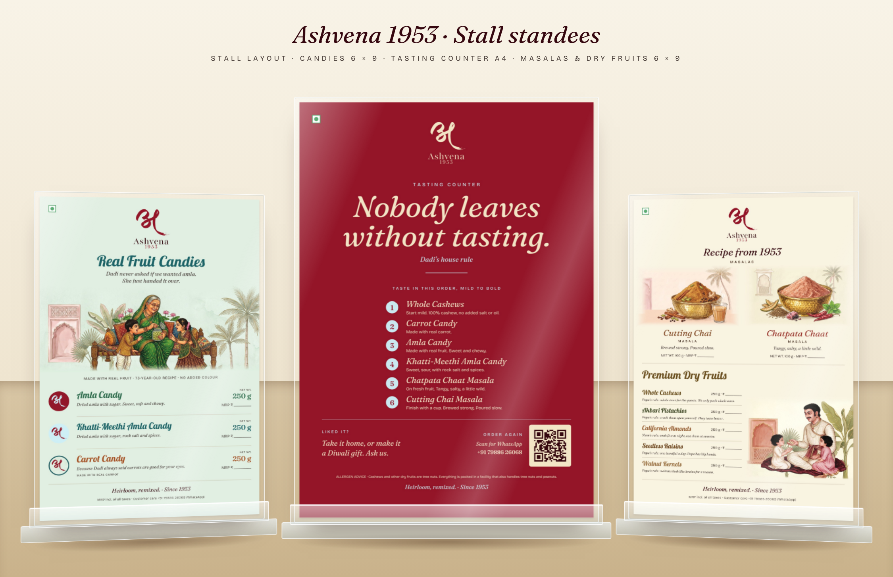

# Ashvena 1953: Stall signage

Cards for the stall's acrylic T-stands: two 6 × 9 in menus, two 6 × 9 in display cards and an A4 tasting-counter card. All are built to the **Ashvena Brand & Packaging Guidelines 2026 (v1.0)**.


| File | What it is |
|---|---|
| `stall-standees/ashvena-standee_real-fruit-candies.*` | Standee 1: Amla Candy, Khatti-Meethi Amla Candy, Carrot Candy |
| `stall-standees/ashvena-standee_masalas-dry-fruits.*` | Standee 2: Cutting Chai and Chatpata Chaat masalas (recipe from 1953), plus the premium dry fruits |
| `stall-standees/ashvena-display_red-no-shortcuts.*` | Display card, Ashvena Red: "No shortcuts. Ever." |
| `stall-standees/ashvena-display_blue-house-rule.*` | Display card, lid blue: "Nobody leaves without tasting." |
| `stall-standees/ashvena-a4_tasting-counter-red.*` / `-blue.*` | A4 tasting counter (centre stand): six-taste flight, gifting ask, WhatsApp QR |
| `*.svg` | Editable master (live text, named layers: `Logo_Stacked`, `Title`, `Illustration`, `Product_*`, `Footer`, `Guides`) |
| `*.pdf` | Print proof with fonts embedded |
| `*.png` | Preview |
| `brand/ashvena-logo-stacked.svg` | Vector stacked logo, lifted from guidelines p. 4 |
| `stall-standees/art/` | Approved watercolour art and candy lids, cropped from the guidelines (see below) |

## Size
- **Trim:** 152.4 × 228.6 mm (6 × 9 in).
- **Artboard:** 158.4 × 234.6 mm, which includes **3 mm bleed** on every side. The A4 card is 210 × 297 mm trim, so its artboard is 216 × 303 mm. Trim marks are on the hidden `Guides` layer.
- **Safe area:** 6 mm inside the trim. The bottom ~10 mm of the trim sits behind the stand's front lip, so it carries no copy.

## How the guidelines are applied
- **Logo:** the stacked logo (अ mark + Ashvena + 1953), centred at the top, in its original colours, on a light wall. Its clear space is at least the height of the word "Ashvena". The veg mark sits top-left.
- **Type:**
  - Lobster for titles on the heritage ranges only: *Real Fruit Candies*, the candy names, *Premium Dry Fruits* and the dry-fruit names.
  - Fraunces (9 pt optical size) for the modern masala titles, taglines and the sign-off.
  - Bricolage Grotesque (14 pt) for category words, NET WT., the MRP lines and the claims strip.
- **Colour:** each title uses its range's title colour from p. 6:

  | Product | Title colour |
  |---|---|
  | Amla Candy | #2D6C4C |
  | Khatti-Meethi Amla Candy | #1C6467 |
  | Carrot Candy | #A85325 |
  | Cutting Chai | #81461F |
  | Chatpata Chaat | #982820 |
  | Whole Cashews | #6C5020 |
  | Akbari Pistachios | #414A27 |
  | California Almonds | #985E31 |
  | Walnut Kernels | #9A7040 |
  | Seedless Raisins | #6D441B |

  Seedless Raisins uses its darkest range colour, because its title colour #D3992C is too pale at list size.
- **Walls:** the backgrounds are the range walls: Khatti-Meethi aqua-sage for the candies, warm cream for the pantry card.
- **Illustration:** only approved art is used. The candy card carries the Dadi scene (heritage), the masalas the hammered brass bowls with no people (modern), and the dry fruits the Papa scene (heritage). The art was cropped clear of the baked-in type, and its edges were faded into the wall in software. No bowl or figure is cropped, and none sits under type.
- **Copy:** taglines come from the copy library (p. 26). The candy claims strip uses the allowed claims only, and Carrot carries its own "Made with real carrot". The sign-off is "Heirloom, remixed. · Since 1953". The customer-care line is the fixed text.

## Copy deck

**Standee 1: Real Fruit Candies**

| | Name | Line | Pack |
|---|---|---|---|
| Title | Real Fruit Candies | *Dadi never asked if we wanted amla. She just handed it over.* | |
| Strip | | MADE WITH REAL FRUIT · 73-YEAR-OLD RECIPE · NO ADDED COLOUR | |
| 1 | Amla Candy | *Dried amla with sugar. Sweet, soft and chewy.* | NET WT. 250 g · MRP ₹ ____ |
| 2 | Khatti-Meethi Amla Candy | *Dried amla with sugar, rock salt and spices.* | NET WT. 250 g · MRP ₹ ____ |
| 3 | Carrot Candy | *Because Dadi always said carrots are good for your eyes.* · MADE WITH REAL CARROT | NET WT. 250 g · MRP ₹ ____ |

**Standee 2: Masalas & Dry Fruits**

| | Name | Line | Pack |
|---|---|---|---|
| Head | *Recipe from 1953* · MASALAS | | |
| 1 | *Cutting Chai* MASALA | *Brewed strong. Poured slow.* | NET WT. 100 g · MRP ₹ ____ |
| 2 | *Chatpata Chaat* MASALA | *Tangy, salty, a little wild.* | NET WT. 100 g · MRP ₹ ____ |
| Head | Premium Dry Fruits | | |
| 3 | Whole Cashews | *Papa's rule: whole ones for the guests. We only pack whole ones.* | 250 g · ₹ ____ |
| 4 | Akbari Pistachios | *Papa's rule: crack them open yourself. They taste better.* | 250 g · ₹ ____ |
| 5 | California Almonds | *Mum's rule: soak five at night, eat them at sunrise.* | 250 g · ₹ ____ |
| 6 | Seedless Raisins | *Papa's rule: one handful a day. Papa has big hands.* | 250 g · ₹ ____ |
| 7 | Walnut Kernels | *Papa's rule: walnuts look like brains for a reason.* | 250 g · ₹ ____ |

**Footer (both):** *Heirloom, remixed. · Since 1953* · MRP incl. of all taxes · Customer care +91 79886 26068 (WhatsApp)

## Display cards



These two type-led cards go in the same 6 × 9 in stands, between the menus. They mirror the candy lids (guidelines p. 19). The Amla lid is red with a light-blue mark, and the Khatti-Meethi lid is light blue (#CBE9F1) with a red mark.

**Red card (Ashvena Red #941528)**
- The logo is the one-colour Heirloom Cream version. The guidelines allow it only on a solid dark ground.
- The text is cream, with light-blue accents.

| Part | Text |
|---|---|
| Kicker | 73 YEARS IN |
| Display | *No shortcuts. Ever.* |
| Story | In 1947, when our family crossed the border, they carried one thing with them. An intention to do everything with purity. With honesty. |
| Close | *That's why everything we make feels like home.* |
| Sign-off | *Heirloom, remixed. · Since 1953* · SONIPAT, INDIA |

All of this is approved story text (guidelines p. 3). The promise line is set as the display.

**Blue card (lid blue #CBE9F1)**
- The logo is in its original colours.
- The display is Ashvena Red, and the body text is Ink.

| Part | Text |
|---|---|
| Kicker | THE HOUSE RULE |
| Display | *"Nobody leaves without tasting."* |
| Attribution | *Dadi, every single day* |
| Body | Ask us for a taste of our candies, masalas and dry fruits. |
| Range | CANDIES · MASALAS · DRY FRUITS |
| Sign-off | *Heirloom, remixed. · Since 1953* · SONIPAT, INDIA |

This is new copy in the brand voice. Use it only if the stall offers tastings. Dadi is a heritage character, so the card sits best beside the candies.

**Alternate lines.** Swap them into `MESSAGES` in `scripts/generate_standees.py`.

| Card | Alternates |
|---|---|
| Red | *Same recipes since 1953.* · *Everything we make feels like home.* |
| Blue | *Papa's rule: try one before you pick a jar.* · *Taste first. Then decide.* |

## Stall layout: two 6 × 9 in stands + one A4 stand



| Position | Card | Job |
|---|---|---|
| Left (6 × 9) | Real Fruit Candies | Menu and prices for the candies |
| **Centre (A4)** | **Tasting counter**, Ashvena Red (`ashvena-a4_tasting-counter-red.*`) | Stops people, guides the tasting, then hands off to buying, gifting and WhatsApp |
| Right (6 × 9) | Masalas & Dry Fruits | Menu and prices for the masalas and dry fruits |

**Why this layout (from the research):**
- **Sampling sells, most of all for small sellers with a short range.** A *Journal of Retailing* study of six scanner datasets found that sampling lifted sales both right away and over the following weeks. It worked better than end-of-aisle displays, and smaller stores with less variety gained the most ([BYU](https://marriott.byu.edu/stories/faculty-research/free-samples-increase-sales)).
- **Sampling also brings in people who weren't planning to buy.** A grocery field study found it pulled them into the category ([Heilman et al., *British Food Journal* 2011](https://www.emeraldinsight.com/doi/pdfplus/10.1108/00070701111177674)). So tasting gets the centre spot, and both menus sit within one glance of it.
- **Keep the tasting short and in a set order.** In the jam study, the 24-jam table stopped more passers-by (60 % against 40 %). But about 30 % of tasters bought at the 6-jam table, against about 3 % at the 24-jam table ([Lumen summary](https://courses.lumenlearning.com/waymaker-psychology/?p=7485), [Tim Harford](https://timharford.com/2009/11/given-the-choice-how-much-choice-would-you-like/)).
  - The bold centre card does the stopping, and the six-item flight does the converting.
  - The order runs mild to bold, so each taste still reads: cashew, then sweet candy, then sweet-sour candy, then tangy chaat, ending on warm chai.
- **Diwali is a dry-fruit gifting season.** Dry fruit remains the traditional premium Diwali gift, with demand driven by higher-income and corporate buyers ([Packaging South Asia](https://packagingsouthasia.com/supply-chain-function/design-marketing/premiumizing-diwali-gift-packs/), [Agro & Food Processing](https://agronfoodprocessing.com/festive-cheer-lifts-indias-dry-fruit-trade-as-imports-prices-surge-ahead-of-diwali/)). The card asks "Make it a Diwali gift. Ask us."
- **Size the type for distance.** The sign-industry rule of thumb is about 1 in of letter height per 10 ft of viewing distance ([Signs.com](https://www.signs.com/blog/?p=16381), [SignsNY](https://signsny.com/resources/distance-visibility/)).
  - The A4 headline (about 15 mm caps) reads from about 2 m, across the counter.
  - The menus are sized for reading within arm's reach, once someone has stopped.

**On the day:**
- Stand the A4 on a small riser behind the sample trays, so the trays never cover the headline.
- Offer each taste on its own spoon or toothpick, and keep the trays covered. The allergen line is already on the card.
- Keep a few ready-packed gift boxes next to the tasting counter, so a "yes" can be packed straight away.
- Chatpata Chaat is served on fresh fruit and Cutting Chai as a cup, so plan for both, or change those two notes in `TASTING`.
- Most acrylic T-stands are double-sided. If yours are, slide the red **"No shortcuts. Ever."** card into the back of one 6 × 9 stand to face people walking up from that side. The blue house-rule card now repeats the A4 message, so keep it as a spare. You can also use the blue A4 (`ashvena-a4_tasting-counter-blue.*`) if the red one sits next to a red backdrop.

**A4 tasting counter: copy**
- **Kicker:** TASTING COUNTER
- **Display:** *Nobody leaves without tasting.*
- **Attribution:** *Dadi's house rule*
- **Order:** TASTE IN THIS ORDER, MILD TO BOLD

| # | Name | Note |
|---|---|---|
| 1 | *Whole Cashews* | Start mild. 100% cashew, no added salt or oil. |
| 2 | *Carrot Candy* | Made with real carrot. |
| 3 | *Amla Candy* | Made with real fruit. Sweet and chewy. |
| 4 | *Khatti-Meethi Amla Candy* | Sweet, sour, with rock salt and spices. |
| 5 | *Chatpata Chaat Masala* | On fresh fruit. Tangy, salty, a little wild. |
| 6 | *Cutting Chai Masala* | Finish with a cup. Brewed strong. Poured slow. |

- **Take-home:** LIKED IT? *Take it home, or make it a Diwali gift. Ask us.*
- **Order again:** ORDER AGAIN · *Scan for WhatsApp* · +91 79886 26068. The QR is vector and points to `https://wa.me/917988626068`; it was checked by decoding the render.
- **Footer:** the allergen advice line, then *Heirloom, remixed. · Since 1953*

## Before print, fill in or confirm
- **MRP:** fill `MRP` in `scripts/generate_standees.py` (for example `{"amla": "180"}`) and regenerate. Any MRP left empty prints a write-in line.
- **New copy (not in the copy library):**
  - "Real Fruit Candies" and "Recipe from 1953", which match the allowed 73-year-old-recipe claim.
  - The Amla Candy line *"Dried amla with sugar. Sweet, soft and chewy."*: check it against that candy's ingredients.
  - The Khatti-Meethi line is its legal descriptor from the tin.
- **Pack sizes:**
  - Candies: 250 g (tin spec).
  - Masalas: 100 g.
  - Dry fruits: 250 g. The Walnut Kernels jar is taller, so confirm its weight.
- **Colour:** the PDFs are RGB proofs. The guidelines print in CMYK, so convert in Illustrator from the HEX values, or have the printer do it.
- **CorelDRAW:** outline the text first (guidelines p. 27).
- **Art resolution:** the art comes from the scenes embedded in the guidelines PDF, about 150 to 200 ppi of real detail, upscaled 2× for print. That is fine for a table standee. For a sharper print, re-crop from the 300 ppi masters in *Final Packaging Designs* using the same file names in `stall-standees/art/`.

## Fonts
Fraunces (9 pt optical size), Bricolage Grotesque (14 pt optical size) and Lobster. All three are free Google Fonts under the SIL OFL. Install them before opening the SVGs.

## Regenerate
```
pip install playwright pillow fonttools
python3 scripts/prepare_standee_art.py Ashvena-Brand-Packaging-Guidelines-2026.pdf   # art/ + logo (needs poppler)
python3 scripts/generate_standees.py                                              # SVG masters
python3 scripts/render_previews.py signage                                        # PNG + PDF
python3 scripts/render_standee_board.py                                           # mockup boards
```
